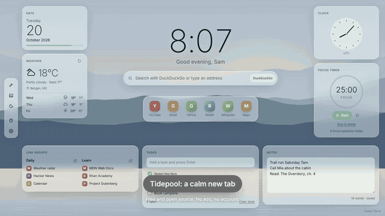
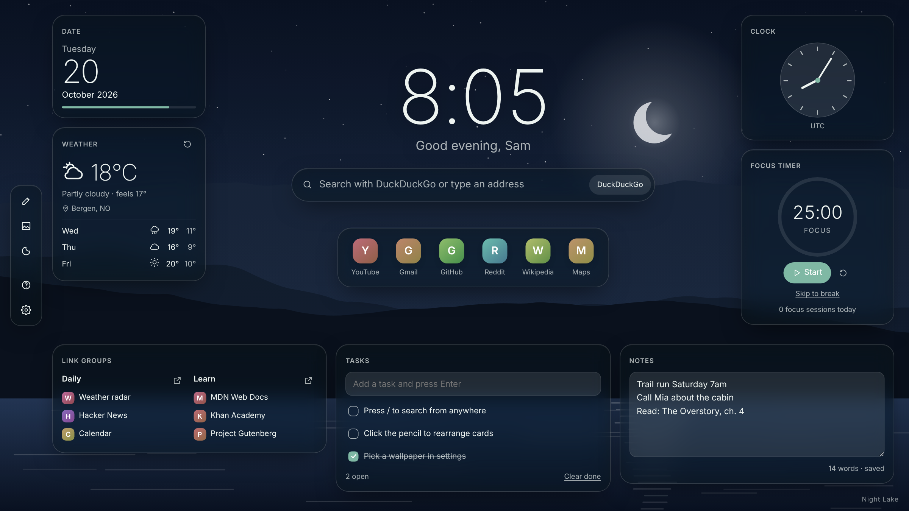
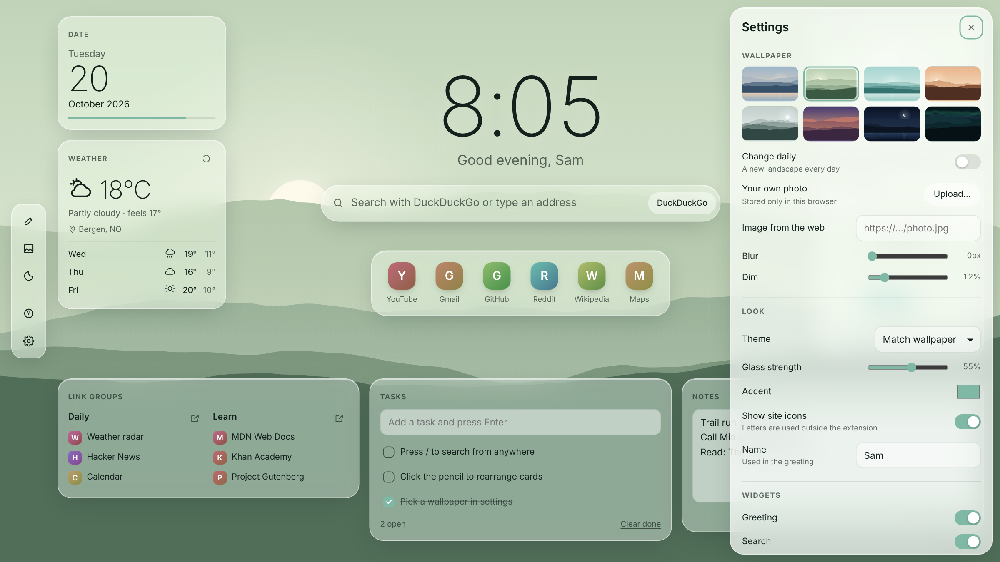
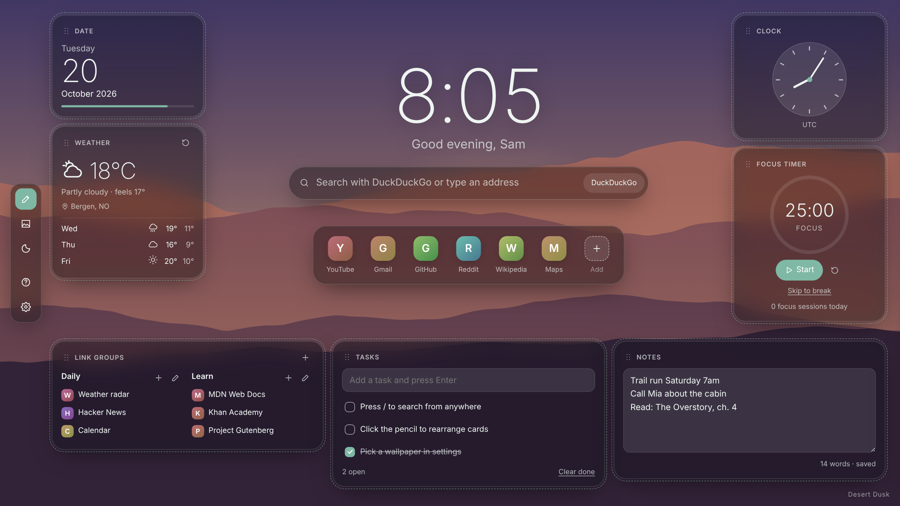
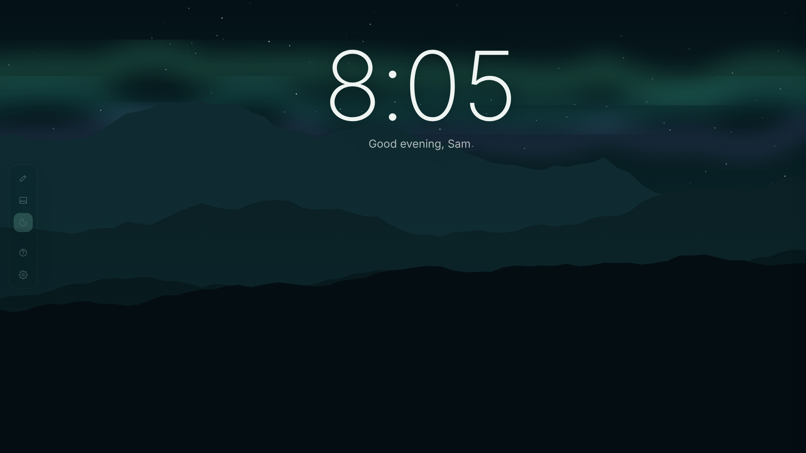
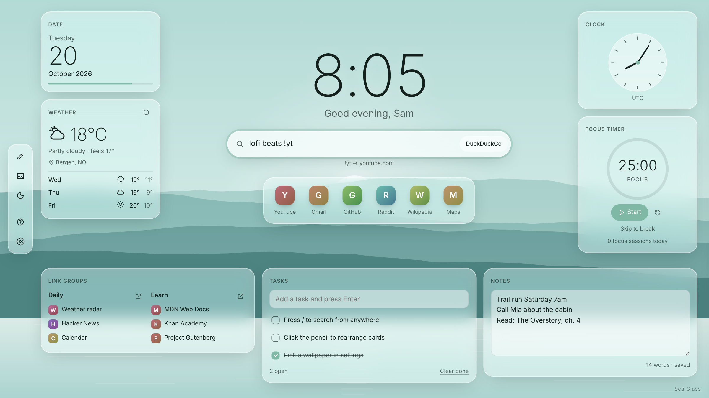
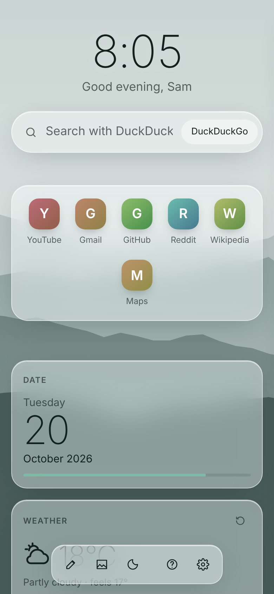
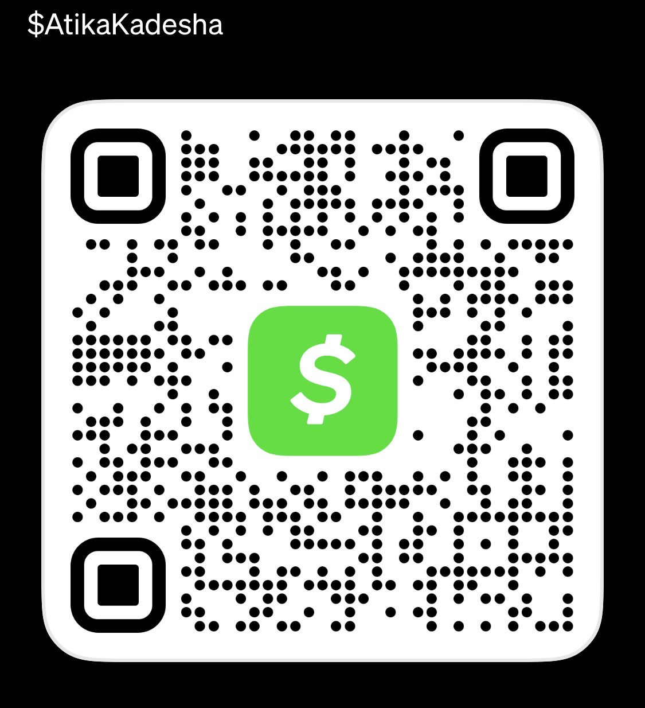

<div align="center">


# Tidepool

**A calm, glass new tab for every browser.**
Clock, weather, search, favorites, link groups, tasks, notes and a focus timer over original landscape art.
Free and open source. No ads, no account, no paywall.

Chrome · Edge · Brave · Opera · Vivaldi · Firefox, on Windows, macOS and Linux



[Demo video (MP4)](docs/demo.mp4) · [Install](#install) · [Features](#features) · [Compared to paid dashboards](#compared-to-paid-new-tab-dashboards)

</div>

---

## Install

Ready-made zips for every browser are on the [Releases](https://github.com/llamaboi55/tidepool/releases/latest) page. Store listings (Firefox Add-ons, Edge Add-ons) are on the way, so you'll be able to install with one click and get updates automatically.

**Build it yourself in one command** (any OS, needs Git and Node.js 18+):

```sh
git clone https://github.com/llamaboi55/tidepool && cd tidepool && npm run build
```

That writes `dist/chromium/`, `dist/firefox/` and ready-to-share zips. No dependencies are downloaded.

**Chrome, Edge, Brave, Opera, Vivaldi**

1. Open `chrome://extensions` (or `edge://extensions`, `brave://extensions`, …).
2. Turn on **Developer mode**.
3. Click **Load unpacked** and pick the repo folder (or `dist/chromium`).
4. Open a new tab. When the browser asks whether to keep the new tab page, choose **Keep it**.

**Firefox**

1. Open `about:debugging#/runtime/this-firefox`.
2. Click **Load Temporary Add-on…** and pick `dist/firefox/manifest.json`.

**Just look at it** (no install): `npm start`, then open <http://localhost:5173/?demo>.

## Features

| | |
|---|---|
| **Original wallpapers** | 8 landscapes (Dawn Fjord, Moss Valley, Sea Glass, Autumn Ridge, Pine Mist, Desert Dusk, Night Lake, Aurora) drawn as SVG at runtime, so they stay sharp on any screen and add almost nothing to the download. Optional new scene every day. |
| **Your own photos** | Upload any image (kept in this browser only) or paste an image address. Blur and dim sliders keep text readable. |
| **Glass that adapts** | Light or dark glass picked automatically from the wallpaper's brightness, adjustable glass strength and accent color. |
| **Search** | DuckDuckGo, Google, Bing, Brave Search, Startpage, Ecosia, Kagi or any custom engine. Type an address to go straight there. |
| **Search shortcuts** | `!yt`, `!g`, `!d`, `!b`, `!w`, `!gh`, `!r`, `!m`, `!a` anywhere in the box. |
| **Favorites dock** | Unlimited favorites with the browser's own cached site icons (no third-party icon service), or tidy color monograms. |
| **Link groups** | Unlimited groups and links, drag to reorder, open a whole group in one click. |
| **Tasks** | Add with Enter, edit in place, check off, clear done. |
| **Notes** | Autosaving scratchpad with word count. |
| **Focus timer** | 25/5 focus and break cycles with a soft chime. Keeps counting across tabs and restarts, and shows the countdown in the tab title. |
| **Clock and date** | Analog, digital or both; 12/24 h; year-progress bar. |
| **Weather** | Current conditions and 3-day outlook from [Open-Meteo](https://open-meteo.com) (no API key, no account). Only the city you choose is sent. |
| **Your layout** | Edit mode (pencil or `E`): drag cards between left, right and bottom; hide any widget. |
| **Calm mode** | `C` hides everything but the time and the landscape. |
| **Keyboard first** | `/` search, `E` edit, `W` wallpaper, `C` calm, `S` settings, `T` task, `N` notes, `Space` timer, `?` help. |
| **Your data** | Stored in your browser. Optional sync through your own browser account. One-click JSON backup and restore. |
| **Accessible** | Works with the keyboard, labelled controls, respects reduced-motion. |

<table>
<tr>
<td></td>
<td></td>
</tr>
<tr>
<td></td>
<td></td>
</tr>
<tr>
<td></td>
<td align="center"></td>
</tr>
</table>

## Compared to paid new tab dashboards

Checked on 2026-10-20 against GNTD: Glass New Tab Dashboard (gntd.us), whose free tier shows ads and whose Premium plan is $13.99/year.

| | Tidepool | GNTD free | GNTD Premium |
|---|:---:|:---:|:---:|
| Price | **Free forever** | Free | $13.99 / year |
| Ads | **None** | Yes | None |
| Account needed for sync | **No** (uses your browser's own sync) | Yes | Yes |
| Link folders | **Unlimited** | Limited ("more folders with Premium") | More |
| Firefox | **Yes** | — | — |
| Source code | **Open (MIT)** | Closed | Closed |
| Backup to a file you own | **Yes** | — | Cloud sync |
| Focus timer, search shortcuts, calm mode | **Yes** | — | — |
| Wallpapers, widgets, notes, tasks | Yes | Yes | Yes |

"—" means not listed on gntd.us when checked. Tidepool is an independent project built from scratch and is not affiliated with GNTD or its developer.

## Privacy

- No analytics, no ads, no remote code. The page's Content Security Policy only allows scripts that ship inside the extension.
- Permissions: `storage` (your settings) and, on Chromium, `favicon` (reads icons your browser already cached). Nothing else.
- Network requests happen only when you use them: weather (Open-Meteo), and search or links you open.

## Development

```sh
npm start        # preview at http://localhost:5173/?demo  (demo mode uses sample weather)
npm test         # unit tests (node:test, no dependencies)
npm run build    # dist/ zips for Chromium and Firefox
```

Plain HTML, CSS and ES modules. No framework, no bundler, no `node_modules`.

```
manifest.json         Chromium manifest (the build derives the Firefox one)
src/newtab.html       the page
src/css/tidepool.css  all styles (light and dark glass)
src/js/main.js        layout, wallpaper, theme, keyboard
src/js/state.js       state, defaults and migrations
src/js/store.js       chrome.storage / localStorage / IndexedDB
src/js/scenes.js      generated landscape wallpapers
src/js/url.js         URL safety, search engines, shortcuts
src/js/widgets/       time, weather, links, focus (tasks, notes, timer)
scripts/              build (zero-dependency zip writer) and preview server
```

Issues and ideas are welcome.

## License

[MIT](LICENSE). Use it, change it, share it.

---

<div align="center">

**Tidepool is free and always will be.** If it made your browser a little calmer, you can leave a tip. It's never required, and nothing is locked behind it.



Cash App: **$AtikaKadesha**

</div>
